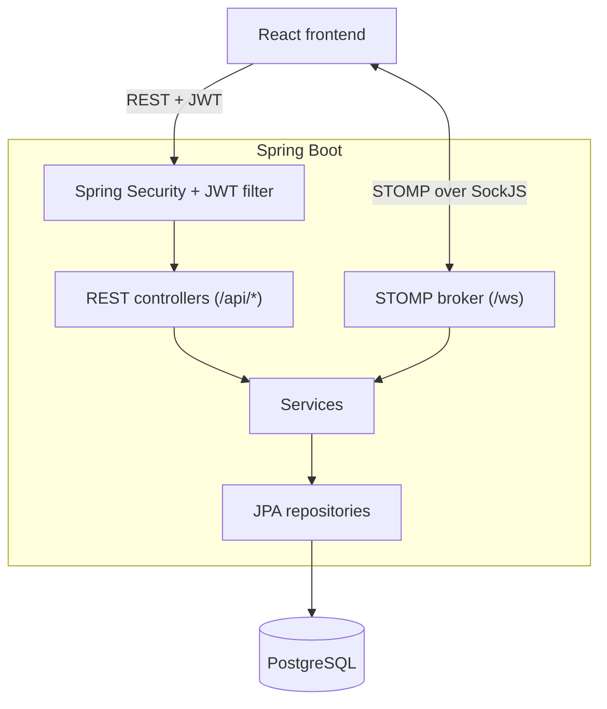

# TeamFlow

TeamFlow is a team collaboration app. You create a workspace, invite people with a short code, chat with them in channels in real time, and keep track of who's working on what.

The backend is built with Spring Boot 4 and PostgreSQL. The frontend is built with React 19, TypeScript and Tailwind CSS. They communicate over a JWT-secured REST API and STOMP WebSockets.

[](https://openjdk.org/)
[](https://spring.io/projects/spring-boot)
[](https://react.dev/)
[](https://www.typescriptlang.org/)
[](https://www.postgresql.org/)

## Contents

- [What it does](#what-it-does)
- [What's next](#whats-next)
- [Tech stack](#tech-stack)
- [Project structure](#project-structure)
- [Running it locally](#running-it-locally)
- [Configuration](#configuration)
- [API reference](#api-reference)
- [WebSocket reference](#websocket-reference)

## What it does

### Workspaces and roles

Each workspace is separate from the others and has its own members, channels and tasks. When you create one, it gets an 8-character invite code and a `#general` channel. To join a workspace, you enter its code. The input box handles paste and backspace properly, so you can drop the code straight in.

There are three roles:

- **Owner**: the person who created the workspace. Only the owner can delete it.
- **Admin**: can invite and remove members and change their roles.
- **Member**: can chat, view tasks and leave the workspace.

The `/workspaces` page lists every workspace you belong to. The app remembers which one you had open, so a page refresh doesn't bounce you back.

### Chat

Every workspace can have as many channels as you want. Messages are delivered live over WebSockets and saved in PostgreSQL, so the history is still there when you come back. In a channel you can:

- **Reply** to a specific message. Your reply shows a quoted preview of the original.
- **Edit** your own messages. Edited messages are marked as edited.
- **Delete** a message. Authors can delete their own messages, and admins and owners can delete anyone's. A deleted message stays in the conversation as "This message was deleted".
- **React** with an emoji. Clicking the same reaction again removes it.

Edits, deletes and reactions all reach everyone in the channel straight away, without a refresh.

### Tasks

Tasks belong to a workspace. Each task has a title, description, assignee, priority (`LOW`, `MEDIUM`, `HIGH` or `CRITICAL`) and deadline. Its status is one of `TODO`, `IN_PROGRESS`, `BLOCKED` or `COMPLETED`.

The tasks page shows counts at the top: total, in progress, completed and overdue. You can filter tasks by status, priority or assignee (including "assigned to me") and search them by text. Filtering and pagination happen on the server. Opening a task shows its details and a comment thread.

Who can do what:

- Owners and admins create, edit and delete tasks.
- The assignee, plus any admin or owner, can change a task's status.
- Everyone in the workspace can view tasks and comment on them.

### Accounts

Accounts use email and password. Passwords are hashed with BCrypt, and sessions are stateless JWTs. The same token that authenticates REST requests is checked again when the WebSocket connects. On the settings page you can update your profile and see your role in each workspace.

## What's next

- [ ] Team directory (the `/team` page is a placeholder for now)
- [ ] Dashboard with real activity data
- [ ] Direct messages
- [ ] File and image attachments (the message types already exist in the schema)
- [ ] Live task updates over WebSocket
- [ ] Notifications for mentions and task assignments. The settings page has the toggles, but nothing is connected to them yet.

## Tech stack

| Area | What's used |
| :--- | :--- |
| Frontend | React 19, TypeScript 6, Vite 8 |
| Styling | Tailwind CSS v4, Lucide icons, Sonner for toasts |
| Routing and state | React Router v7, React Context (TanStack Query is installed but not used yet) |
| Real-time client | `@stomp/stompjs` with `sockjs-client` |
| Backend | Spring Boot 4.1, Java 21 |
| Security | Spring Security, JJWT 0.12.6, BCrypt |
| Messaging | Spring WebSocket with the built-in STOMP broker |
| Database | PostgreSQL, Spring Data JPA (Hibernate), Lombok |
| API docs | springdoc-openapi (Swagger UI) |

Here's how a request flows through the backend:



For step-by-step diagrams of login, authenticated REST calls, WebSocket chat and error handling, see [docs/ARCHITECTURE.md](docs/ARCHITECTURE.md).

## Project structure

```text
Team-Flow/
├── backend/
│   └── src/main/java/com/teamflow/backend/
│       ├── Config/        WebSocket, CORS and OpenAPI setup
│       ├── Controller/    REST and STOMP endpoints
│       ├── Entity/        JPA entities and enums
│       ├── Repository/    Spring Data repositories
│       ├── Security/      JWT handling and Spring Security config
│       ├── Service/       Business logic and permission checks
│       ├── dto/           Request and response objects
│       └── Exception/     Custom exceptions and the global handler
│
└── frontend/
    └── src/
        ├── api/           Axios instance and API helpers
        ├── components/    Layouts, sidebars, modals, task components
        ├── context/       Auth, workspace and channel state
        ├── hooks/         useStompClient
        ├── pages/         One file per route
        └── types/         Shared TypeScript types
```

## Running it locally

You'll need JDK 21, Node.js 20 or newer, and PostgreSQL 14 or newer. You don't need to install Maven, because the repo includes the Maven Wrapper.

**1. Create the database.**

```sql
CREATE DATABASE teamflow;
```

You don't have to create any tables. Hibernate creates them on first run.

**2. Start the backend.**

First, put your database credentials and a JWT secret in `backend/src/main/resources/application.properties` (see [Configuration](#configuration)). Then run:

```bash
cd backend
./mvnw spring-boot:run        # on Windows: mvnw.cmd spring-boot:run
```

The API runs at `http://localhost:8080`, and the Swagger docs are at `http://localhost:8080/swagger-ui.html`.

**3. Start the frontend.**

```bash
cd frontend
npm install
npm run dev
```

Open `http://localhost:5173`. Both servers bind to `0.0.0.0`, so other devices on your network can open the app too, which helps when testing on a phone.

Other useful commands:

| Command | Run in | What it does |
| :--- | :--- | :--- |
| `npm run build` | `frontend/` | Type-checks and builds for production |
| `npm run lint` | `frontend/` | Runs ESLint |
| `./mvnw test` | `backend/` | Runs the backend tests |
| `./mvnw clean package` | `backend/` | Builds the backend JAR |

## Configuration

### Backend (`application.properties`)

| Property | What it's for |
| :--- | :--- |
| `spring.datasource.url` | The database URL, e.g. `jdbc:postgresql://localhost:5432/teamflow` |
| `spring.datasource.username` / `password` | Your PostgreSQL login |
| `spring.jpa.hibernate.ddl-auto` | How Hibernate manages the schema. It's set to `update`. |
| `jwt.secret` | A Base64-encoded key of at least 512 bits |
| `jwt.exp` | How long a token lasts, in milliseconds. The default of `864000000` is 10 days. |
| `server.address` | The address the server binds to. It's set to `0.0.0.0`. |

To generate a secret, run:

```bash
openssl rand -base64 64
```

Keep real passwords and secrets out of git. Outside local development, set them through environment variables such as `SPRING_DATASOURCE_PASSWORD` and `JWT_SECRET`. Spring picks those up automatically.

### Frontend (`frontend/.env`)

| Variable | What it's for |
| :--- | :--- |
| `VITE_API_URL` | The base URL of the API. If it isn't set, the app uses `http://<current-host>:8080/api`. |

## API reference

Every response comes wrapped in the same `ApiResponse<T>` shape. Every endpoint outside `/api/auth` needs an `Authorization: Bearer <token>` header. The Swagger UI has the full request and response schemas. The tables below are a quick reference.

### Auth

| Method | Endpoint | Description | Who |
| :--- | :--- | :--- | :--- |
| `POST` | `/api/auth/register` | Create an account | Anyone |
| `POST` | `/api/auth/login` | Log in and get a token | Anyone |

### Users

| Method | Endpoint | Description | Who |
| :--- | :--- | :--- | :--- |
| `GET` | `/api/users/me` | Get your profile | Logged in |
| `PUT` | `/api/users/me` | Update your profile | Logged in |

### Workspaces

| Method | Endpoint | Description | Who |
| :--- | :--- | :--- | :--- |
| `GET` | `/api/workspaces` | List your workspaces | Logged in |
| `POST` | `/api/workspaces` | Create a workspace | Logged in |
| `GET` | `/api/workspaces/{id}` | Get workspace details and members | Member |
| `POST` | `/api/workspaces/join` | Join with an invite code | Logged in |
| `POST` | `/api/workspaces/{id}/members` | Invite someone by email | Admin, Owner |
| `DELETE` | `/api/workspaces/{id}/members/{userId}` | Remove a member | Admin, Owner |
| `PUT` | `/api/workspaces/{id}/members/{userId}/role` | Change someone's role | Admin, Owner |
| `POST` | `/api/workspaces/{id}/leave` | Leave a workspace | Member, Admin |
| `DELETE` | `/api/workspaces/{id}` | Delete a workspace | Owner |

### Channels and messages

| Method | Endpoint | Description | Who |
| :--- | :--- | :--- | :--- |
| `GET` | `/api/workspaces/{workspaceId}/channels` | List channels | Member |
| `POST` | `/api/workspaces/{workspaceId}/channels` | Create a channel | Member |
| `GET` | `/api/channels/{channelId}/messages` | Get message history | Member |
| `PUT` | `/api/messages/{id}` | Edit a message | Author |
| `DELETE` | `/api/messages/{id}` | Delete a message | Author, Admin, Owner |
| `POST` | `/api/messages/{id}/reactions` | Add or remove a reaction, e.g. `{ "emoji": "👍" }` | Member |

### Tasks

| Method | Endpoint | Description | Who |
| :--- | :--- | :--- | :--- |
| `POST` | `/api/workspaces/{workspaceId}/tasks` | Create a task | Admin, Owner |
| `GET` | `/api/workspaces/{workspaceId}/tasks` | List tasks | Member |
| `GET` | `/api/tasks/{id}` | Get one task | Member |
| `PUT` | `/api/tasks/{id}` | Update a task | Admin, Owner |
| `PATCH` | `/api/tasks/{id}/status` | Change the status | Assignee, Admin, Owner |
| `DELETE` | `/api/tasks/{id}` | Delete a task | Admin, Owner |
| `POST` | `/api/tasks/{id}/comments` | Add a comment | Member |
| `GET` | `/api/tasks/{id}/comments` | List comments | Member |

The task list accepts these query parameters:

- Filters: `status`, `priority`, `assigneeId` and `search`.
- Paging: `page` and `size` (20 by default).
- Sorting: `sort` (newest first by default).

Here's an example request body for creating a task:

```json
{
  "title": "Set up CI pipeline",
  "description": "GitHub Actions for backend and frontend",
  "assigneeId": 3,
  "priority": "HIGH",
  "deadline": "2026-11-15T17:00:00"
}
```

## WebSocket reference

Connect to `/ws` using SockJS, and pass your token in the STOMP `CONNECT` headers as `Authorization: Bearer <token>`.

To send a message, publish to `/app/chat.sendMessage`. The `replyToId` field is optional:

```json
{
  "channelId": 1,
  "content": "Hello team!",
  "replyToId": 42
}
```

To receive messages, subscribe to `/topic/channel/{channelId}`. You'll get a `MessageResponse` every time a message in that channel is sent, edited, deleted or reacted to. The frontend matches each update to an existing message by its ID.
