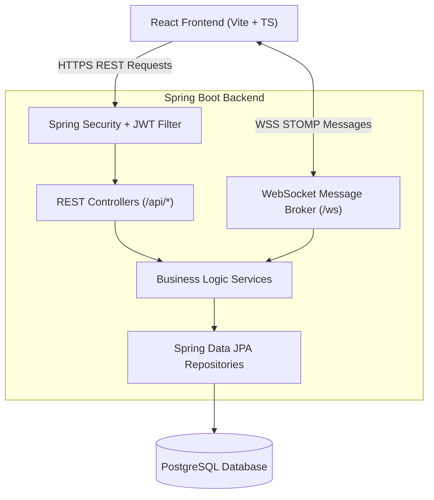

# TeamFlow 🚀

> A modern, real-time team collaboration and workspace management platform designed for seamless team communication, workspace isolation, and productivity.

[](https://openjdk.org/)
[](https://spring.io/projects/spring-boot)
[](https://react.dev/)
[](https://www.typescriptlang.org/)
[](https://tailwindcss.com/)
[](https://www.postgresql.org/)
[](https://stomp.github.io/)

---

## 📌 Table of Contents

- [About the Project](#-about-the-project)
- [Key Features](#-key-features)
  - [Completed Till Now](#-completed-till-now)
  - [In Progress & Upcoming](#-in-progress--upcoming)
- [Architecture & Tech Stack](#-architecture--tech-stack)
- [Project Structure](#-project-structure)
- [API & WebSocket Specifications](#-api--websocket-specifications)
  - [REST Endpoints](#rest-endpoints)
  - [WebSocket Topics & Messages](#websocket-topics--messages)
- [Getting Started](#-getting-started)
  - [Prerequisites](#prerequisites)
  - [Backend Setup](#backend-setup)
  - [Frontend Setup](#frontend-setup)
- [Screenshots & UI Showcase](#-screenshots--ui-showcase)
- [Contributing](#-contributing)
- [License](#-license)

---

## 📖 About the Project

**TeamFlow** is an all-in-one team collaboration hub inspired by Slack and modern workflow tools. It enables organizations to create isolated workspaces, manage member roles, organize topic-based channels, and communicate via real-time messaging with sub-second message delivery.

The application is built on a full-stack architecture featuring **Spring Boot 4** and **PostgreSQL** on the backend, with a responsive **React 19**, **TypeScript**, and **Tailwind CSS** frontend communicating over REST and authenticated **STOMP WebSockets**.

---

## ✨ Key Features

### ✅ Completed Till Now

#### 1. Authentication & Security
- **JWT-Based Authentication**: Secure stateless authentication using JSON Web Tokens.
- **Password Hashing**: BCrypt encryption for user credentials.
- **Protected Routing**: Client-side route guards ensuring only authenticated users access workspaces and dashboards.
- **WebSocket Auth Interceptor**: Custom `ChannelInterceptor` verifying JWT tokens directly on STOMP `CONNECT` frames.
- **Global Error Handling**: Standardized error responses using `@ControllerAdvice` and unified `ApiResponse<T>` wrappers.

#### 2. Workspace Management & Multi-Tenancy
- **Workspace Creation**: Easily provision workspaces with auto-generated unique 8-character invite codes.
- **Default Channel Initialization**: Every new workspace automatically generates a `#general` channel.
- **Invite Code Joining**: Interactive 8-character OTP-style input UI with auto-focus advance, paste support, and backspace handling.
- **Workspace Hub (`/workspaces`)**: Central launcher to browse joined workspaces, switch active context, or join/create workspaces.
- **Context Persistence**: Synchronized workspace state across browser reloads using React Context and `localStorage`.

#### 3. Role-Based Access Control (RBAC)
- **Three-Tier Role Hierarchy**: `OWNER`, `ADMIN`, and `MEMBER`.
- **Role Assignment**: Workspace creators are automatically assigned `OWNER` privileges.
- **Role Management**: Owners and admins can promote or demote member roles.
- **Member Moderation**: Privileged users can remove members from the workspace.
- **Self-Service Actions**: Members can voluntarily leave workspaces; owners have exclusive rights to permanently delete workspaces.

#### 4. Real-Time Channels & Messaging
- **Channel Organization**: Create topic-specific discussion channels within workspaces (e.g., `#general`, `#development`).
- **Live WebSocket Messaging**: Instant real-time messaging using `@stomp/stompjs` and Spring WebSocket Message Broker (`/topic/channel/{channelId}`).
- **Persistent Message History**: Messages are stored in PostgreSQL with timestamping, sender metadata, and channel association.
- **Chat Interface**: Clean chat area with auto-scrolling to the latest message, sender initials/avatars, connection status indicators, and channel headers.

#### 5. User Profile & Preferences
- **Profile Overview**: View registered name, email, and workspace roles.
- **Profile Updates**: Custom avatar fallbacks, role labels, and account settings interface.
- **Notification Settings UI**: Preference toggles for mentions, task assignments, and activity digests.

---

### 🚧 In Progress & Upcoming

- [ ] **Direct Messaging (DMs)**: Private 1-on-1 real-time conversations.
- [ ] **Message Reactions**: Interactive emoji reactions on messages (backend schema already modeled).
- [ ] **Tasks & Kanban Board**: Task tracking with statuses, assignees, and deadlines (`/tasks`).
- [ ] **Team Directory**: Searchable list of all team members across the organization (`/team`).
- [ ] **File Attachments**: Upload and share images and documents in channels.
- [ ] **Push Notifications**: Browser notifications for incoming messages and mentions.

---

## 🛠️ Architecture & Tech Stack

### High-Level Architecture



### Technology Breakdown

| Layer | Technologies |
| :--- | :--- |
| **Frontend Framework** | React 19, TypeScript, Vite |
| **Styling & UI** | Tailwind CSS v4, Lucide React, Sonner (Toasts) |
| **Client Routing & State** | React Router DOM v7, React Context API, TanStack React Query |
| **Real-time Client** | `@stomp/stompjs`, `sockjs-client` |
| **Backend Framework** | Spring Boot 4.1.0, Java 21 |
| **Security & Auth** | Spring Security 6, JJWT (`io.jsonwebtoken 0.12.6`), BCrypt |
| **Messaging & Sockets** | Spring WebSocket, STOMP Protocol, In-Memory Message Broker |
| **Database & Persistence** | PostgreSQL, Spring Data JPA, Hibernate, Lombok |
| **Build Tools** | Maven (Backend), npm (Frontend) |

---

## 📂 Project Structure

```text
Team-Flow/
├── backend/
│   ├── src/main/java/com/teamflow/backend/
│   │   ├── Config/              # WebSocket & Web CORS configurations
│   │   ├── Controller/          # REST & WebSocket Controllers (Auth, Workspace, Chat, User)
│   │   ├── Entity/              # JPA Entities (User, Workspace, WorkspaceMember, Channel, Message)
│   │   │   └── Enum/            # Enums (Role: OWNER, ADMIN, MEMBER)
│   │   ├── Repository/          # Spring Data JPA Repositories
│   │   ├── Security/            # JWT Token Provider, Filters, UserDetailsService, SecurityConfig
│   │   ├── Service/             # Core business logic (Auth, Workspace, Channel, Message, User)
│   │   ├── dto/                 # Request & Response Data Transfer Objects
│   │   └── Exception/           # Centralized exception handlers
│   ├── src/main/resources/
│   │   └── application.properties # Server port, database connection, JWT secret
│   └── pom.xml                  # Maven dependencies
│
├── frontend/
│   ├── src/
│   │   ├── api/                 # Axios client with interceptors
│   │   ├── components/          # Reusable UI (Sidebar, Modals, MessageLayout, ProtectedRoute)
│   │   ├── context/             # AuthContext, WorkspaceContext, ChannelContext
│   │   ├── pages/               # Views (Login, Register, Workspaces, Dashboard, ChatArea, Settings)
│   │   ├── App.tsx              # Application routing & layout tree
│   │   └── main.tsx             # Entry point
│   ├── package.json             # NPM dependencies & scripts
│   ├── tailwind.config.js       # Styling configuration
│   └── vite.config.ts           # Vite build configuration
└── README.md
```

---

## 📡 API & WebSocket Specifications

### REST Endpoints

#### Authentication (`/api/auth`)
| Method | Endpoint | Description | Access |
| :--- | :--- | :--- | :--- |
| `POST` | `/api/auth/register` | Register a new user account | Public |
| `POST` | `/api/auth/login` | Authenticate and obtain JWT token | Public |

#### Workspaces (`/api/workspaces`)
| Method | Endpoint | Description | Access |
| :--- | :--- | :--- | :--- |
| `GET` | `/api/workspaces` | Get all workspaces for current user | Authenticated |
| `POST` | `/api/workspaces` | Create a new workspace (auto-creates `#general`) | Authenticated |
| `GET` | `/api/workspaces/{id}` | Get workspace details and member list | Members |
| `POST` | `/api/workspaces/join` | Join workspace using 8-character code | Authenticated |
| `POST` | `/api/workspaces/{id}/members` | Invite a member by email | Admin/Owner |
| `DELETE` | `/api/workspaces/{id}/members/{userId}` | Remove a member from workspace | Admin/Owner |
| `PUT` | `/api/workspaces/{id}/members/{userId}/role` | Update a member's role (`ADMIN`, `MEMBER`) | Admin/Owner |
| `POST` | `/api/workspaces/{id}/leave` | Leave a workspace | Member/Admin |
| `DELETE` | `/api/workspaces/{id}` | Delete workspace permanently | Owner |
| `GET` | `/api/workspaces/{id}/channels` | List all channels in workspace | Members |
| `POST` | `/api/workspaces/{id}/channels` | Create a new channel in workspace | Members |

#### Messages (`/api/channels`)
| Method | Endpoint | Description | Access |
| :--- | :--- | :--- | :--- |
| `GET` | `/api/channels/{channelId}/messages` | Retrieve message history for channel | Workspace Member |

#### User Profile (`/api/users`)
| Method | Endpoint | Description | Access |
| :--- | :--- | :--- | :--- |
| `GET` | `/api/users/me` | Fetch authenticated user profile | Authenticated |
| `PUT` | `/api/users/me` | Update authenticated user details | Authenticated |

---

### WebSocket Topics & Messages

- **Handshake Endpoint**: `/ws` (with SockJS fallback)
- **Authentication**: Sent in STOMP headers: `Authorization: Bearer <JWT_TOKEN>`
- **Publish Message**:
  - Destination: `/app/chat.sendMessage`
  - Payload:
    ```json
    {
      "channelId": 1,
      "content": "Hello team!"
    }
    ```
- **Subscribe Topic**:
  - Destination: `/topic/channel/{channelId}`
  - Receives `MessageResponse` payload containing message ID, content, sender info, timestamp, and channel ID.

---

## 🚀 Getting Started

### Prerequisites

Make sure you have the following installed on your machine:
- **Java Development Kit (JDK) 21+**
- **Apache Maven 3.8+**
- **Node.js 18+** and **npm**
- **PostgreSQL 14+**

---

### Backend Setup

1. **Configure PostgreSQL Database**:
   Create a database named `teamflow`:
   ```sql
   CREATE DATABASE teamflow;
   ```

2. **Configure Database Credentials**:
   Edit `backend/src/main/resources/application.properties` with your database credentials:
   ```properties
   spring.datasource.url=jdbc:postgresql://localhost:5432/teamflow
   spring.datasource.username=your_postgres_username
   spring.datasource.password=your_postgres_password
   
   jwt.secret=your_base64_encoded_jwt_secret_key_here
   jwt.exp=864000000
   ```

3. **Build and Run the Backend**:
   ```bash
   cd backend
   ./mvnw clean spring-boot:run
   ```
   The backend server will start at `http://localhost:8080`.

---

### Frontend Setup

1. **Navigate to the frontend folder**:
   ```bash
   cd frontend
   ```

2. **Install dependencies**:
   ```bash
   npm install
   ```

3. **Start the development server**:
   ```bash
   npm run dev
   ```
   The frontend application will be live at `http://localhost:5173`.

---

## 🎨 Screenshots & UI Showcase

| Workspace Hub | Real-Time Chat |
| :---: | :---: |
| *Browse and switch between workspaces with custom invite codes* | *Instant real-time communication across topic channels* |

| Workspace Settings | Role Management |
| :---: | :---: |
| *Manage workspace members, transfer ownership, or configure general details* | *Granular permissions for Owners, Admins, and Members* |

---

## 🤝 Contributing

Contributions are welcome! If you would like to contribute:

1. Fork the Project.
2. Create your Feature Branch (`git checkout -b feature/AmazingFeature`).
3. Commit your Changes (`git commit -m 'Add some AmazingFeature'`).
4. Push to the Branch (`git push origin feature/AmazingFeature`).
5. Open a Pull Request.

---

## 📄 License

This project is open-source and available under the [MIT License](LICENSE).
