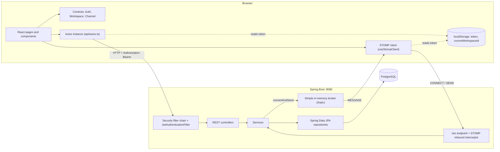
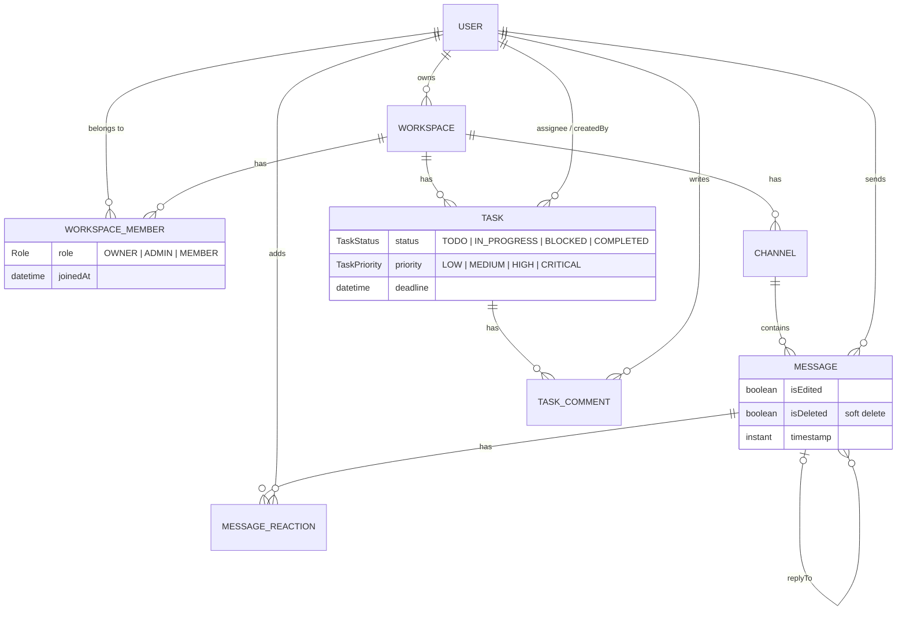
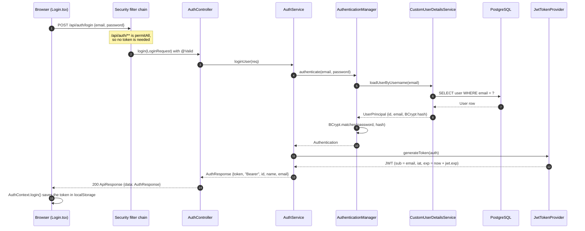
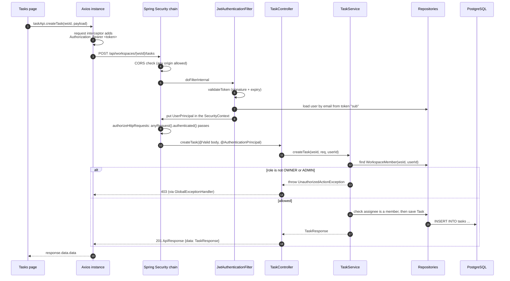
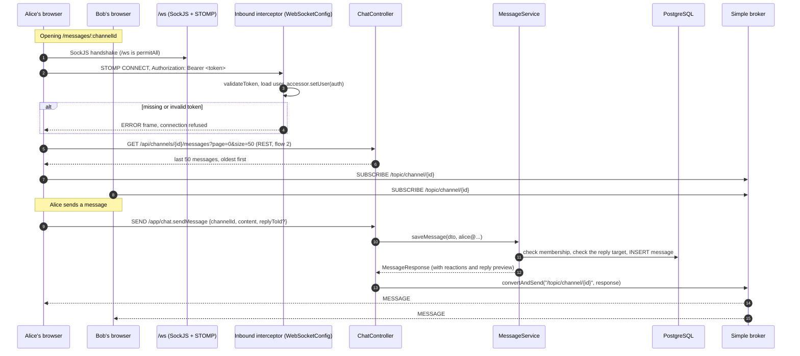

# TeamFlow architecture

This document explains how TeamFlow is built: which technologies it uses, how the code is laid out, and what happens to a request from the moment a user clicks something in the browser to the moment a row changes in PostgreSQL. For setup steps and the endpoint list, see the [README](../README.md).

## Contents

- [Big picture](#big-picture)
- [Technologies](#technologies)
- [Backend layers](#backend-layers)
- [Frontend structure](#frontend-structure)
- [Data model](#data-model)
- [Request flows](#request-flows)
  - [1. Register and log in](#1-register-and-log-in)
  - [2. An authenticated REST request](#2-an-authenticated-rest-request)
  - [3. Restoring a session on page load](#3-restoring-a-session-on-page-load)
  - [4. Real-time chat over WebSocket](#4-real-time-chat-over-websocket)
  - [5. Editing, deleting and reacting](#5-editing-deleting-and-reacting)
  - [6. Errors](#6-errors)
- [Authorization model](#authorization-model)
- [Known gaps](#known-gaps)

## Big picture

TeamFlow is two applications that talk over the network:

- A **React single-page app** (`frontend/`), served by Vite on port `5173`.
- A **Spring Boot API** (`backend/`) on port `8080`, backed by **PostgreSQL**.

They use two channels:

1. **HTTP/JSON (REST)** under `/api/*` for everything that reads or changes data: accounts, workspaces, channels, tasks, message history, edits, deletes and reactions.
2. **STOMP over SockJS (WebSocket)** at `/ws` for live chat. The browser publishes new messages, and the server pushes every new or changed message to everyone subscribed to that channel.

Both are authenticated with the same **JWT**, which the browser keeps in `localStorage`.



## Technologies

### Backend

| Technology | Version | What it does in TeamFlow |
| :--- | :--- | :--- |
| Java | 21 | Language and runtime. The JVM runs in UTC (`-Duser.timezone=UTC` in `pom.xml`). |
| Spring Boot | 4.1.0 | Application framework, auto-configuration and the embedded web server. |
| Spring Web MVC | from Boot | REST controllers (`@RestController`, `@GetMapping`, ...). |
| Spring Security | from Boot | Stateless security filter chain, CORS, route protection and BCrypt password hashing. |
| JJWT | 0.12.6 | Signs and verifies JWTs with HMAC-SHA (`JwtTokenProvider`). |
| Spring WebSocket + STOMP | from Boot | The `/ws` endpoint with a SockJS fallback, the `/app` prefix for client messages and a simple in-memory broker for `/topic` and `/queue`. |
| Spring Data JPA / Hibernate | from Boot | Entities, repositories, derived queries, `Specification`-based task filtering and pagination. `ddl-auto=update` creates and updates tables. |
| PostgreSQL JDBC driver | runtime | Database connection. |
| Jakarta Bean Validation | from Boot | `@Valid`, `@NotBlank` and similar annotations on request DTOs. |
| Lombok | from Boot | `@Data`, `@Builder` and `@RequiredArgsConstructor` to cut boilerplate. |
| springdoc-openapi | 2.8.5 | Swagger UI at `/swagger-ui.html`, with a `bearerAuth` scheme (`OpenAPIConfig`). |
| Maven Wrapper | — | Builds without a global Maven install (`./mvnw`). |

### Frontend

| Technology | Version | What it does in TeamFlow |
| :--- | :--- | :--- |
| React | 19 | UI library. |
| TypeScript | ~6.0 | Static types (`types/task.ts` and component props). |
| Vite | 8 | Dev server and production bundler. A small custom plugin serves the static landing page at `/landing/`. |
| React Router | 7 | Client-side routing, with `ProtectedRoute` guarding the app. |
| React Context | — | Global state for the logged-in user, the current workspace and the channel list. |
| Axios | 1.x | HTTP client. One shared instance attaches the JWT to every request. |
| `@stomp/stompjs` + `sockjs-client` | 7.x / 1.6 | WebSocket chat client, with automatic reconnect every 5 seconds. |
| Tailwind CSS | v4 | Styling, driven by design tokens in `src/styles/tokens.css` (see `DESIGN.md`). |
| Lucide React | — | Icons. |
| Sonner | 2 | Toast notifications. |
| ESLint + typescript-eslint | — | Linting. |

`@tanstack/react-query` and `recharts` are installed but not used by any code yet. Data fetching is currently done with Axios inside `useEffect` hooks and context providers.

## Backend layers

The backend follows the usual Spring layering. Each layer only calls the one below it.

```text
com.teamflow.backend
├── Security/     JwtAuthenticationFilter, JwtTokenProvider, SecurityConfig,
│                 CustomUserDetailsService, UserPrincipal
├── Config/       WebSocketConfig (STOMP + JWT check on CONNECT), OpenAPIConfig, WebConfig
├── Controller/   HTTP and STOMP entry points. They parse input, find the caller
│                 and wrap the result in ApiResponse.
├── Service/      Business rules: membership and role checks, invite codes, task
│                 filtering, building message responses, pushing WebSocket events.
├── Repository/   Spring Data JPA interfaces (findByEmail, existsByWorkspaceIdAndUserId, ...).
├── Entity/       JPA entities and enums (Role, TaskStatus, TaskPriority, MessageType).
├── dto/          Request and response objects, plus the ApiResponse<T> envelope.
└── Exception/    ResourceNotFound, UnauthorizedAction and BadRequest exceptions,
                  and the GlobalExceptionHandler that maps them to HTTP status codes.
```

| Layer | Responsibility | Example |
| :--- | :--- | :--- |
| Controller | Maps a URL or STOMP destination to a method, validates the body, finds the current user | `TaskController.createTask` |
| Service | Checks permissions, runs business logic, owns the transaction (`@Transactional`) | `TaskService.createTask` checks that the caller is OWNER or ADMIN |
| Repository | Database access | `TaskRepository` with `Specification` filters |
| Entity | Maps tables to Java objects | `Task`, `WorkspaceMember` |
| DTO | The shape of the JSON on the wire, so entities never leak directly | `TaskResponse`, `MessageResponse` |

Every REST response uses one envelope, `dto/ApiResponse.java`:

```json
{
  "success": true,
  "message": "Task created successfully",
  "data": { "...": "..." },
  "timestamp": "2026-11-01T10:15:30"
}
```

On errors, `success` is `false` and `data` is left out. That's why the frontend always reads `response.data.data`.

## Frontend structure

```text
frontend/src
├── main.tsx            Mounts <AuthProvider> → <WorkspaceProvider> → <ChannelProvider> → <App/>
├── App.tsx             Routes. Public: /login, /register. Everything else sits under <ProtectedRoute/>.
├── api/
│   ├── axios.ts        The shared Axios instance and the interceptor that adds the Bearer token
│   └── task.ts         Typed task API helpers (taskApi.*)
├── context/
│   ├── AuthContext     user, isAuthenticated, login(), logout(); checks /users/me on load
│   ├── WorkspaceContext  workspace list and the current workspace (remembered in localStorage)
│   └── ChannelContext  channels of the current workspace
├── hooks/
│   └── useStompClient  Opens one STOMP connection with the JWT in the CONNECT headers
├── components/         Layouts, sidebars, modals, task cards
└── pages/              One file per route (Tasks, ChatArea, WorkspaceSettings, ...)
```

The route tree:

```text
/login, /register                    public
<ProtectedRoute>                     waits for AuthContext, otherwise redirects to /login
  /                                  redirects to /dashboard, or to /workspaces if you have none
  /workspaces                        workspace hub (no sidebar)
  <DashboardLayout>                  sidebar + nav
    /dashboard  /tasks  /team  /settings  /workspace-settings
    /messages → /messages/:channelId (ChatArea)
```

## Data model



`WorkspaceMember` is the join table between users and workspaces, and it is where the per-workspace **role** lives. Almost every permission check in the services starts by loading this row.

## Request flows

### 1. Register and log in

Login is the only flow that produces a token. Every later request depends on it.



**Register** (`POST /api/auth/register`) works the same way. `AuthService.registerUser` first checks that the email isn't taken, saves the user with a BCrypt-hashed password, and then runs the same authenticate-and-sign step, so the user is logged in straight away.

If authentication fails, `AuthController` catches the exception and returns `401` with "Invalid email or password".

### 2. An authenticated REST request

This example creates a task, but every protected endpoint follows the same path.



Step by step:

1. **Axios interceptor** (`frontend/src/api/axios.ts`) reads `token` from `localStorage` and sets the `Authorization: Bearer ...` header. The base URL is `VITE_API_URL`, or `http://<current-host>:8080/api` if that isn't set.
2. **CORS**: `SecurityConfig` allows any origin pattern with credentials, and `OPTIONS` preflights are always let through.
3. **`JwtAuthenticationFilter`** runs once per request, before Spring's `UsernamePasswordAuthenticationFilter`:
   - It pulls the token out of the `Bearer ` header.
   - `JwtTokenProvider.validateToken` checks the HMAC signature and the expiry.
   - It reads the email from the token's `sub` claim and loads the user from the database through `CustomUserDetailsService`.
   - It stores a `UsernamePasswordAuthenticationToken` in the `SecurityContextHolder`.
   - If anything fails, it logs the problem and carries on **without** authentication. It doesn't reject the request itself.
4. **Authorization rules**: `/api/auth/**`, `/ws/**` and the Swagger paths are public. Everything else needs an authenticated user, so a request without a valid token is rejected here. The session policy is `STATELESS`, so nothing is stored on the server between requests.
5. **Controller**: Spring binds path variables and query parameters, validates the body with `@Valid`, and injects the current `UserPrincipal`.
6. **Service**: this is where the *workspace-level* permission check happens (see [Authorization model](#authorization-model)). Write operations run inside `@Transactional`.
7. **Repository → PostgreSQL**: Hibernate turns the calls into SQL. For the task list, `TaskService` builds a JPA `Specification` from `status`, `priority`, `assigneeId` and `search`, and Spring Data applies the `Pageable` (20 per page, newest first by default).
8. **Response**: the controller wraps the DTO in `ApiResponse.success(...)`, and Jackson serialises it to JSON.

### 3. Restoring a session on page load

On every full page load, `AuthContext` checks whether the saved token still works:

1. `isLoading = true`, so `ProtectedRoute` shows "Verifying session…".
2. If there's a `token` in `localStorage`, it calls `GET /api/users/me`. That request goes through flow 2.
3. On success it stores the user and sets `isAuthenticated = true`. On failure, for example an expired token, it removes the token.
4. `isLoading = false`. `ProtectedRoute` then either renders the page or redirects to `/login`.

After that, `WorkspaceContext` loads `GET /api/workspaces` and restores `currentWorkspaceId` from `localStorage`, and `ChannelContext` loads `GET /api/workspaces/{id}/channels` for that workspace.

### 4. Real-time chat over WebSocket

Chat uses REST for history and STOMP for live traffic.



How it fits together:

- **Connecting**: `useStompClient` creates one STOMP `Client` over `SockJS("http://<host>:8080/ws")` and passes the JWT in the `CONNECT` frame's headers. Browsers can't set custom headers on a WebSocket handshake, so the HTTP handshake itself is public (`/ws/**` is `permitAll`). The real check happens in `WebSocketConfig.configureClientInboundChannel`, which inspects `CONNECT` frames and attaches the authenticated user to the session. The client reconnects automatically after 5 seconds.
- **Destinations**:
  - `/app/...` goes to `@MessageMapping` methods. The only one is `/app/chat.sendMessage`.
  - `/topic/...` goes to the in-memory broker, which fans out to every subscriber. Each channel has its own topic, `/topic/channel/{channelId}`.
- **Sending**: `ChatArea.handleSend` publishes `{content, channelId, replyToId}`. It doesn't add the message to the list itself. The message appears when the server broadcasts it back, so every client shows exactly what was saved.
- **Receiving**: the subscription handler parses each `MessageResponse`. If a message with that `id` is already in the list, it is **replaced**, which handles edits, deletes and reactions. Otherwise it is **appended**.

### 5. Editing, deleting and reacting

These actions go out over **REST** but come back over **WebSocket**, so everyone in the channel sees the change:

```text
Browser ──PUT /api/messages/{id}────────────┐
Browser ──DELETE /api/messages/{id}─────────┤──▶ ChatController ──▶ MessageService
Browser ──POST /api/messages/{id}/reactions─┘                         │
                                                                      ├─ permission check
                                                                      ├─ save to PostgreSQL
                                                                      └─ messagingTemplate.convertAndSend(
                                                                           "/topic/channel/{channelId}",
                                                                           updated MessageResponse)
                                                                                 │
every subscriber in the channel ◀────────────────────────────────────────────────┘
(replaces the message with the same id)
```

- **Edit**: only the author can edit, and not after the message is deleted. Sets `isEdited = true`.
- **Delete**: the author, an ADMIN or the OWNER can delete. It's a *soft* delete: `isDeleted = true` and the content is replaced, so replies to it still have something to point at.
- **React**: toggles a `MessageReaction` row (one per message, user and emoji). `mapToResponse` groups reactions by emoji into `{emoji, count, userIds}`.

### 6. Errors

```text
Service throws ─┬─ ResourceNotFoundException       ─▶ 404
                ├─ UnauthorizedActionException     ─▶ 403
                ├─ BadRequestException             ─▶ 400
                ├─ MethodArgumentNotValidException ─▶ 400  "field: message" (from @Valid)
                └─ any other Exception             ─▶ 500
                          (all via GlobalExceptionHandler → ApiResponse.error(message))
```

There are two different styles in the code right now:

- `TaskController` and `UserController` let exceptions reach `GlobalExceptionHandler`, so you get the status codes above.
- `AuthController`, `ChannelController`, `ChatController` and `WorkspaceController` catch `Exception` themselves and return a fixed status (`400` in most cases, `401` for a failed login). `MessageService` and `WorkspaceService` throw plain `RuntimeException`.

For STOMP messages (`/app/chat.sendMessage`), `@ControllerAdvice` doesn't apply. If `saveMessage` throws, for example because the sender isn't a member, the message is dropped and the sender gets no error.

## Authorization model

There are two levels of permission, and they're checked in different places:

| Level | Where it's stored | Where it's checked | What it decides |
| :--- | :--- | :--- | :--- |
| **Authenticated or not** | the JWT | `SecurityConfig` + `JwtAuthenticationFilter` (and the STOMP interceptor for `/ws`) | Can you call the API at all? |
| **Workspace role** (OWNER, ADMIN, MEMBER) | `workspace_members.role` | inside each **service** method | What you can do inside a given workspace |

Every user gets the same global Spring authority (`ROLE_USER`). Workspace roles are **not** Spring authorities, so there's no `@PreAuthorize`. Instead, each service loads the caller's `WorkspaceMember` row and checks it, for example:

```java
// TaskService.createTask
if (creatorMembership.getRole() != Role.OWNER && creatorMembership.getRole() != Role.ADMIN) {
    throw new UnauthorizedActionException("Only workspace OWNER or ADMIN can create tasks");
}
```

The full "who can do what" table for each endpoint is in the README's [API reference](../README.md#api-reference).

## Known gaps

These are worth knowing when you work on the request flow:

- **One database lookup per request.** `JwtAuthenticationFilter` loads the user from PostgreSQL on every authenticated request. You could avoid this by putting the user id in the token claims.
- **The JWT secret is used as raw bytes.** `JwtTokenProvider.getSigningKey` calls `jwtSecret.getBytes(UTF_8)` and doesn't Base64-decode it. Any string of 64 or more characters works, but the Base64 text is not decoded first.
- **No refresh tokens.** Tokens last `jwt.exp` (10 days). After that, the `/users/me` check on page load fails and the user is sent back to `/login`.
- **Single-instance broker.** `enableSimpleBroker` keeps subscriptions in memory, so live chat only works with one backend instance. Running more than one would need an external broker relay such as RabbitMQ.
- **Errors on the WebSocket path are silent.** See [Errors](#6-errors).
- **The Vite `/api` proxy isn't used by default.** `vite.config.ts` proxies `/api` to `127.0.0.1:8080`, but Axios goes straight to `http://<host>:8080/api` unless `VITE_API_URL` is set to `/api`. The WebSocket URL is always `http://<host>:8080/ws`.
- **No live task updates.** Tasks are plain request and response. Other users see changes only after they reload.
